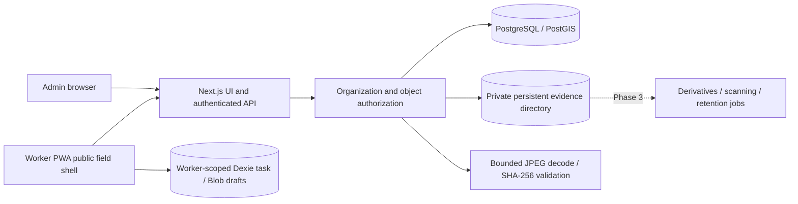

# Architecture

One deployable web app and a shared domain package keep the initial operating footprint small. Raw parameterized SQL provides visible transactions and constraints. Better Auth supplies password hashing, session rotation and origin checks. Role membership is fetched server-side, never accepted from a client claim. No public sign-up. Admin MFA integration is a deployment gate, not a claimed Phase 1 feature.

Production uses PostgreSQL with PostGIS and geographic nearest-candidate queries. Embedded PostgreSQL is permitted for local development and non-spatial integration tests if Docker is unavailable; it does not validate PostGIS. Geographic candidate computation must be tested against PostGIS before M3 release.

Phase 2 deploys to a single persistent application host. Authenticated API proxy reads private evidence after object-level access checks; no public object URLs or client storage secrets exist. Fixed-size multipart pieces and receipts persist in PostgreSQL and a private directory. Writes use a temporary file, file flush and atomic hard link; metadata commits afterwards. Replays bind worker, operation key and canonical metadata digest. Orphans from filesystem/DB crash windows are possible; cleanup is a Phase 3 requirement.

The filesystem backend avoids inventing cloud integration credentials and is sufficient for the first single-host pilot architecture. It does not support ephemeral/serverless disks or multiple unshared hosts. R2/S3 adapter and direct signed access are future deployment options. No evidence media is stored under public assets. Authenticated HTML/API/media responses never enter service-worker caches. Only `/field` (a public shell), static assets and manifest/icons are cached. A deliberately small service worker replaces a general Workbox setup for this bounded cache policy; cache boundaries and offline reload are browser-tested.

JPEG validation currently runs synchronously with 6MB/24MP limits and no malware scanner or perceptual matcher. Move expensive processing into leased background jobs before scaling. Browser GPS, capture connectivity and clock are claims; online challenges prove server issuance/receipt timing only.
