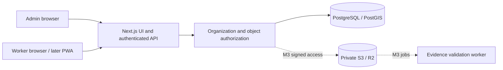

# Architecture

One deployable web app and a shared domain package keep the initial operating footprint small. Raw parameterized SQL provides visible transactions and constraints. Better Auth supplies password hashing, session rotation and origin checks. Role membership is fetched server-side, never accepted from a client claim. No public sign-up. Admin MFA integration is a deployment gate, not a claimed Phase 1 feature.

Production uses PostgreSQL with PostGIS and geographic nearest-candidate queries. Embedded PostgreSQL is permitted for local development and non-spatial integration tests if Docker is unavailable; it does not validate PostGIS. Geographic candidate computation must be tested against PostGIS before M3 release.

Deploy a single application instance initially. Later background jobs use a database outbox with leased jobs before adding Redis. No evidence media is stored under public assets. Authenticated HTML and API responses must not enter shared caches.
