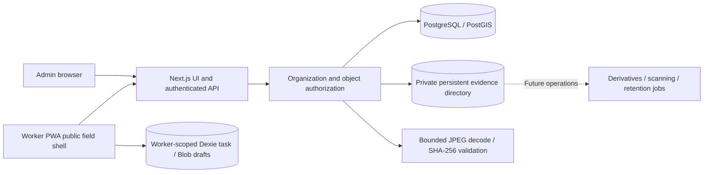

# Architecture

One deployable web app and a shared domain package keep the initial operating footprint small. Raw parameterized SQL provides visible transactions and constraints. Better Auth supplies password hashing, session rotation and origin checks. Role membership is fetched server-side, never accepted from a client claim. No public sign-up. Admin MFA integration is a deployment gate, not a claimed Phase 1 feature.

Production uses PostgreSQL with PostGIS and geographic nearest-candidate queries. Embedded PostgreSQL is permitted for local development and non-spatial integration tests if Docker is unavailable; it does not validate PostGIS. Geographic candidate computation must be tested against PostGIS before M3 release.

Phase 2 deploys to a single persistent application host. Authenticated API proxy reads private evidence after object-level access checks; no public object URLs or client storage secrets exist. Fixed-size multipart pieces and receipts persist in PostgreSQL and a private directory. Writes use a temporary file, file flush and atomic hard link; metadata commits afterwards. Replays bind worker, operation key and canonical metadata digest. Orphans from filesystem/DB crash windows are possible; cleanup remains an operational deployment requirement.

The filesystem backend avoids inventing cloud integration credentials and is sufficient for the first single-host pilot architecture. It does not support ephemeral/serverless disks or multiple unshared hosts. R2/S3 adapter and direct signed access are future deployment options. No evidence media is stored under public assets. Authenticated HTML/API/media responses never enter service-worker caches. Only `/field` (a public shell), static assets and manifest/icons are cached. A deliberately small service worker replaces a general Workbox setup for this bounded cache policy; cache boundaries and offline reload are browser-tested.

JPEG validation currently runs synchronously with 6MB/24MP limits and a versioned perceptual matcher and no malware scanner. Move expensive processing into leased background jobs before scaling. Browser GPS, capture connectivity and clock are claims; online challenges prove server issuance/receipt timing only.

## Phase 3 review boundary
Received inspections and media remain immutable. `review_cases` is a mutable versioned projection; decisions, risk runs, reference versions, reference photo hashes and withdrawal events are append-only tables. Supervisors are existing organization administrators, always authorized server-side. Decisions use optimistic case versions, canonical operation digests and transactional organization/case locks. Same-assessment two-person confirmation is required for nearby faces and high-risk independent-review signals. Supervisor approval and explicit structural baseline enrollment are distinct operations.

Risk analysis reopens bounded originals, decodes JPEGs and recomputes SHA-256/DCT hashes. Production geographic distances and neighboring-face search use PostGIS geography; embedded development tests use a named great-circle fallback. Failures retain server receipts and prevent approval until assessment succeeds. Reports and decisions retain rule/assessment versions. No browser evidence is attested and no weighted probability is presented. Processing is synchronous and bounded, with database-backed admission leases. Durable background jobs remain required before broader scaling.

Resurvey creates a new assignment ID with `parent_inspection_id` and immutable historical receipts. This preserves the Phase 2 one-inspection-per-task and worker-scoped IndexedDB keys. Downloaded tasks carry supervisor reasons/instructions; stale offline views explicitly represent the latest downloaded state, not live supervisor decisions. See PHASE3_API.md and FRAUD_RULES.md for contracts and limits.

## M4 hardening boundary

Migration 004 adds ephemeral analysis admission records; migration 005 adds a received-inspection keyset index. Review pagination retains exact receipt microseconds and organization/filter-bound cursors. Production CSP excludes eval; inline framework scripts/styles remain allowed. Admission limits, explicit failed-analysis recovery and legacy API compatibility are documented in PHASE3_API.md. These controls do not terminate stuck decoder execution or establish production concurrency certification.

Generated-fixture restore and read-only registered-object reconciliation are executable under M4_OPERATIONS.md. The pilot protocol and real-device/staging/backup gates remain separate in M4_PILOT_RUNBOOK.md.
