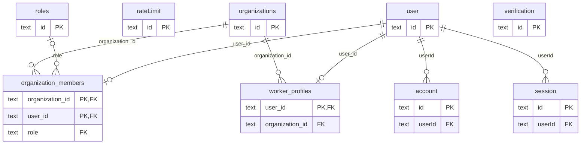
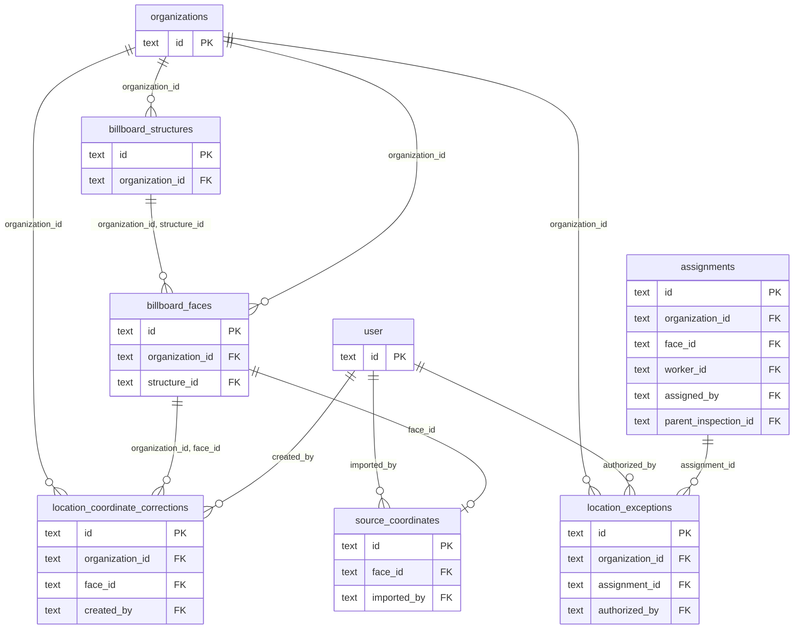
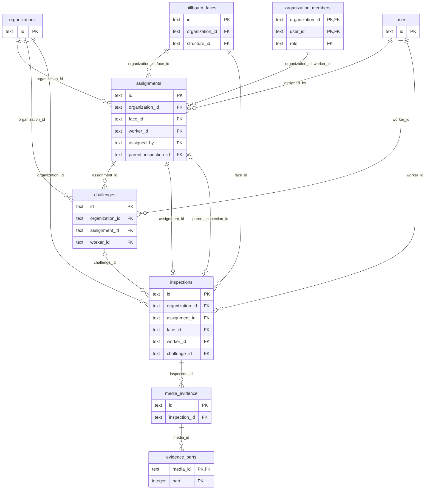
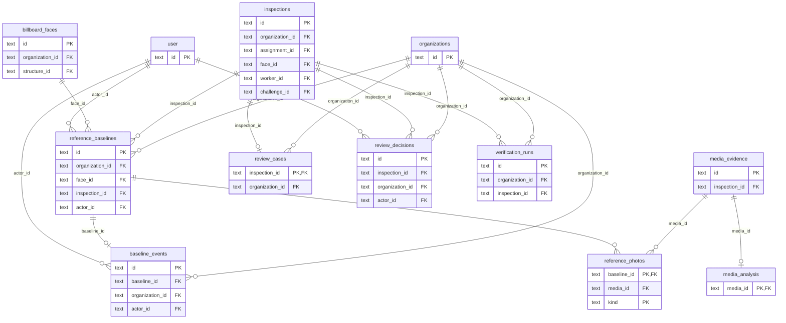
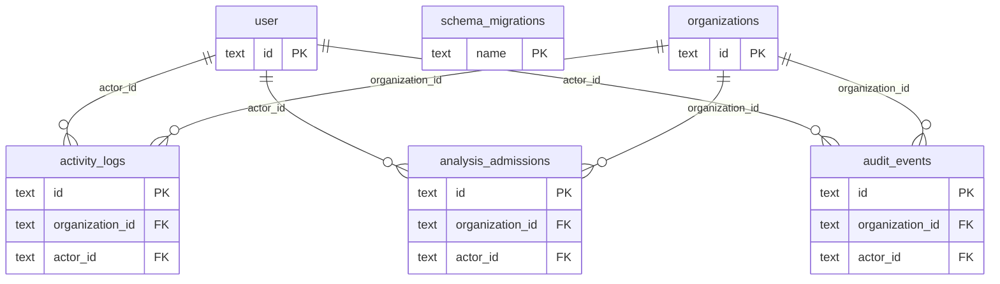

# Database relationships

Generated from the live PostgreSQL foreign keys. Exact nullability, composite keys, partial unique indexes and checks are listed in [the schema reference](DATABASE_SCHEMA.md). Logical service-level links are described there separately.

## Identity and organizations

## Inventory

## Field visits and evidence

## Review and reference baselines

## Audit and operations

