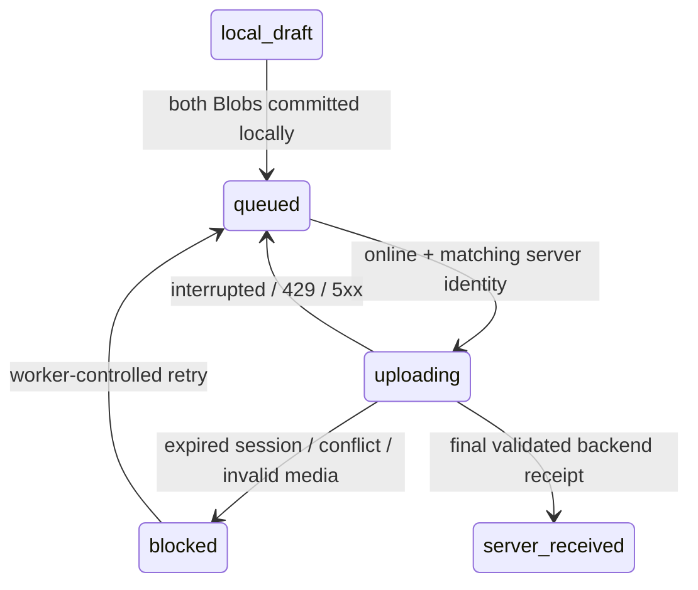

# Offline capture and synchronization (Phase 2)

Workers explicitly download authorized tasks into a Dexie database named by organization and worker ID. Photos are captured only with getUserMedia → canvas JPEG encoding (maximum 2048px long edge); the resulting original Blob, SHA-256, GPS observation, capture connectivity claim and device timestamp are saved atomically. There is no normal gallery input. Front and wide context are independently required before queuing. Live camera tracks stop on hidden page, navigation/unmount and queued state.

Saved locally, queued and uploading are client-only states. The server persists an upload session, part hashes and photo receipts; its inspection/assignment state changes to server_received only after both photographs validate. The local database records the stable final receipt ID and server timestamp. This is not approval. Local originals remain available after receipt; deletion/retention UI is Phase 3 work.

Foreground replay runs on opening/reconnecting and every 10 seconds while open, honoring exponential backoff (2s initial after first failure, capped at 5 minutes). navigator.locks serializes tabs where supported; server idempotency remains authoritative everywhere. Each replay revalidates `/api/me` before any bytes. A different account or expired session blocks the queue instead of sending another worker's photos. Successful login clears the offline identity pointer; logout locks the device view. Offline copies are not fresh server authentication or OS-level encryption.

Each draft freezes worker-scoped operation UUID, task ID/version, original face ID/code and metadata when queued. Upload parts are 256KiB and resume from server manifests. Lost final responses replay to the same receipt. No automatic background execution is promised while the browser is suspended/closed. Manual retry resets the wait; conflicts and invalid images retain originals and require investigation. One attempt per assignment is supported; Phase 3 implements controlled linked resurvey attempts.

The custom service worker installs `/field` and its static asset dependencies. This page is a public shell with no personalized HTML; task/photo data comes exclusively from IndexedDB or authenticated no-store APIs. Auth, API responses, admin HTML and media are never cached by it. Wait for “Offline shell ready” before leaving coverage. Bump the `ibvs-public-field-*` cache version when changing the field shell/assets in a release; updates wait for existing clients to close so a draft is not interrupted. Tile prefetching is absent.

Quota estimates/persistence requests are visible but not guarantees. A quota failure leaves the current photo in memory with “not saved” and a retry button; never close that page until saving succeeds. Eviction/private browsing/storage clearing/device loss can destroy unsynced evidence. No blanket guarantee of data survival is made. Camera/GPS and device clocks are untrusted. A five-minute server challenge is optional online; offline/unchallenged photos and expired-at-receipt challenges remain flagged.

Private filesystem multipart storage is implemented; S3/R2 multipart remains future work. Bounded JPEG decoding, server SHA-256, immutable receipts and access predicates are tested. Browser tests simulate offline reload, denied/successful GPS, media permissions, quota exhaustion, interrupted wide photo upload and receipt replay. Database tests reopen the database mid-upload; real process-kill/power-loss, real phones, OS eviction and production volume recovery remain unperformed operational tests.

## Phase 3 linked resurvey
Supervisor resurvey requests create new task IDs rather than rewriting a received inspection. Downloaded assignments carry parent inspection IDs, specific instructions and supervisor decision reasons. A new task uses its own stable operation UUID and Dexie draft, preserving all existing Blob, receipt, retry and quota semantics. Old task drafts remain recoverable. Download assignments after review to refresh cached outcome information; offline copies cannot know later supervisor decisions. Server receipt remains distinct from approval and explicit reference enrollment. The public shell cache version is bumped for the release; private review pages and API/media responses are never cached.

M4 preserves local Blob/retry behavior. Replaying a received upload returns the existing receipt without re-running image analysis. Analysis failure/throttling does not undo server receipt: a supervisor explicitly reanalyzes before approval. Review mutations now freeze competing navigation/actions until completion; server idempotency and optimistic versions remain the final protection.

Exact M4 reconciliation also tests actual same-browser sign-out/offline device lock, second-worker isolation and original-worker recovery with unchanged original Blob/hash/operation ID. The standalone `npm run test:restart` now verifies actual owned application process termination and resumed HTTP upload against an isolated embedded database. This replaces the earlier unperformed local process-restart note; physical power loss, OS eviction, production/PostGIS/container and real-phone behavior remain separate unverified gates.
